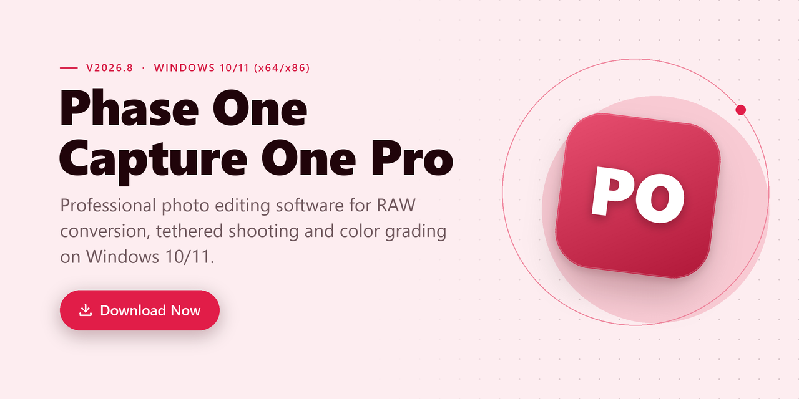

<h1 align="center">Capture One Pro: Professional RAW Photo Editing on Windows</h1>

<p align="center"><i>A Windows reference page for the Phase One Capture One Pro photo editor, RAW conversion, tethered capture, and color grading workflow.</i></p>

<p align="center">
  
  
  
  
</p>

---

<p align="center"></p>

<p align="center">
  <a href="https://arifkowalski946.github.io/capture-one-pro-reference/">
    <picture>
      <source media="(prefers-color-scheme: dark)" srcset="./media/button2.svg">
      
    </picture>
  </a>
</p>

## Overview

Capture One Pro is a professional photo editing application developed by Phase One, a Danish camera and imaging systems manufacturer. It belongs to the category of non-destructive RAW converters and image editors, positioned for photographers who need precise color control, high-volume catalog work, and direct camera connectivity during a shoot.

The application carries a photography project from initial capture through final output. Sessions or catalogs organize imported files, a RAW processing engine interprets sensor data, and a layered adjustment stack applies color, exposure, and lens corrections without altering the source file. Variants and exports derive finished deliverables while the original capture stays intact.

Capture One Pro has been developed continuously since the early 2000s and follows a periodic release cadence, with numbered versions introducing new processing engines and tools. It maintains an established user base among studio, commercial, and editorial photographers, alongside a documented ecosystem of camera profiles, ICC color workflows, and third-party plugin connections.

## Setup

The application is delivered through a guided first-run experience that places program files in the chosen location and registers the necessary imaging components on the system. On first launch it prompts for catalog or session selection, camera profile availability, and interface preferences. Initial indexing of selected folders may take time depending on library size. Subsequent launches reopen the most recent workspace state.

## Who This Page Is For

- **Studio photographers** who shoot tethered and need immediate control over capture and color on set.
- **Commercial and editorial retouchers** who rely on layered adjustments and color grading precision.
- **High-volume catalog editors** who manage large libraries and require consistent batch processing.
- **Technical evaluators** who compare RAW processing engines, format support, and Windows runtime requirements.

## Capabilities

#### RAW Conversion
The core processing engine interprets RAW sensor data from a broad range of camera models using manufacturer-specific profiles. Adjustments are stored as instructions rather than pixel edits, so the original file remains unchanged throughout the workflow.

#### Tethered Capture
Cameras can be connected directly to the workstation, with live preview, focus control, and immediate transfer of frames into a session. This allows review and adjustment during a shoot rather than after it.

#### Color Grading
Dedicated color tools provide control over white balance, hue, saturation, and luminance ranges, along with curve and level adjustments. Color editor modules support targeted correction and consistent output across a series of images.

#### Layer and Mask Editing
Adjustments can be stacked on layers with masks created by brush, gradient, radial, or luminosity selection. This mirrors a compositing approach while keeping all edits non-destructive within the RAW pipeline.

#### Catalog and Session Management
Files are organized either in a long-term catalog with metadata, ratings, and smart albums, or in a lightweight session structure tied to a single shoot. Both models support filtering, keywording, and batch operations.

#### Export and Format Output
Finished images can be rendered to common delivery formats with configurable resolution, color space, sharpening, and metadata settings. Processing recipes can be saved and reused across projects.

## Technical Profile

```
OS           :  Windows 10 (64-bit) or Windows 11
CPU          :  Intel Core i3 or AMD equivalent (quad-core recommended)
RAM          :  8 GB minimum / 16 GB or more recommended
Storage      :  Approximately 10 GB for program files plus working space for catalogs and previews
Display      :  1280 x 800 minimum, 1920 x 1080 or higher recommended
GPU          :  Dedicated GPU with OpenCL support recommended for accelerated processing
Network      :  Internet connection for activation and updates
```

Processing demand scales with the resolution of the source files, the size of the catalog, and the number of active layers. Systems with more RAM and a supported GPU handle large batches and preview rendering with less latency, while modest hardware remains workable for smaller libraries.

## Workflow

After setup the typical photography cycle breaks down into five stages:

1. **Import and Organize** Files are brought into a catalog or session, tagged with metadata, and sorted into albums or projects.
2. **Capture or Select** Phase One Capture One Pro - professional photo editing software for RAW conversion, tethered shooting and color grading on Windows 10/11.
3. **Adjust and Grade** Phase One Capture One Pro - professional photo editing software for RAW conversion, tethered shooting and color grading on Windows 10/11.
4. **Review and Variant** Phase One Capture One Pro - professional photo editing software for RAW conversion, tethered shooting and color grading on Windows 10/11.
5. **Export and Deliver** Phase One Capture One Pro - professional photo editing software for RAW conversion, tethered shooting and color grading on Windows 10/11.

## Environment Notes

Capture One Pro runs on 64-bit Windows 10 and Windows 11, and benefits from current operating system updates for imaging and camera driver support. Camera manufacturers periodically revise their RAW formats, and the application's camera profile library is updated alongside those changes.

The application supports plugin connections for external editors and round-trip workflows, allowing adjustments to be handed off to compatible third-party tools and returned to the catalog. Capture One Live and similar sharing features extend the workflow to remote review without changing local project files.

Hardware headroom matters for large catalogs and high-resolution sensor files. Coexistence with other imaging applications is generally straightforward, though file association preferences and color management settings should be reviewed when several editors share the same workstation.

## Common Questions

<details>
<summary><b>What kind of work is Capture One Pro used for?</b></summary>

It is used for RAW photo processing, tethered studio capture, color grading, catalog management, and batch export of finished images.
</details>

<details>
<summary><b>Does it run on Windows 11?</b></summary>

Yes, Windows 11 is supported alongside 64-bit Windows 10, subject to the minimum hardware profile described above.
</details>

<details>
<summary><b>Does it support third-party plugins?</b></summary>

Yes, plugin connections allow round-trip editing with compatible external applications, and camera profiles are maintained for a wide range of models.
</details>

<details>
<summary><b>How does it interchange with other tools?</b></summary>

Images can be exported in standard delivery formats and color spaces, and catalogs support metadata that travels with exported files. Sidecar and session structures help move projects between workstations.
</details>

<details>
<summary><b>What affects performance?</b></summary>

File resolution, catalog size, preview settings, and GPU support are the main factors. Reducing preview size or splitting large catalogs often resolves sluggish behavior.
</details>

## Notes

Capture One Pro is a product of Phase One. Features, camera support, and system requirements vary by version and are documented by the vendor. Working catalogs and session folders should be backed up regularly, since they contain the adjustments applied to original captures.

## Credits

All product names, logos, and trademarks are the property of their respective owners. License terms are distributed with the application.
